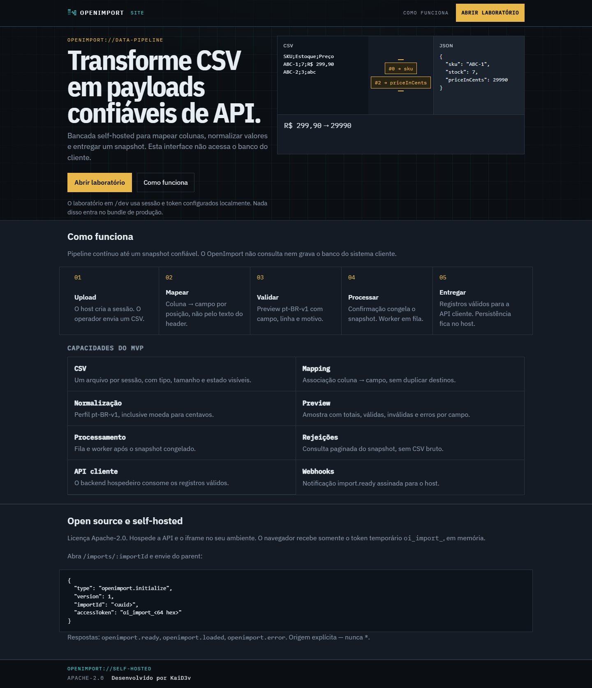
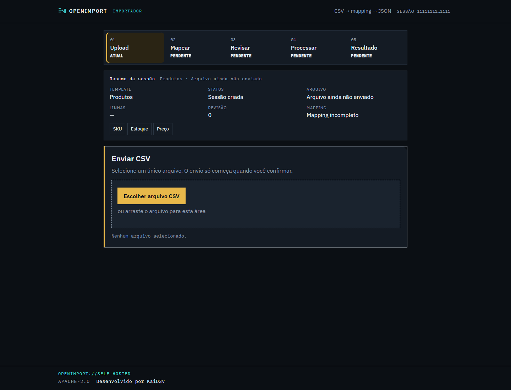
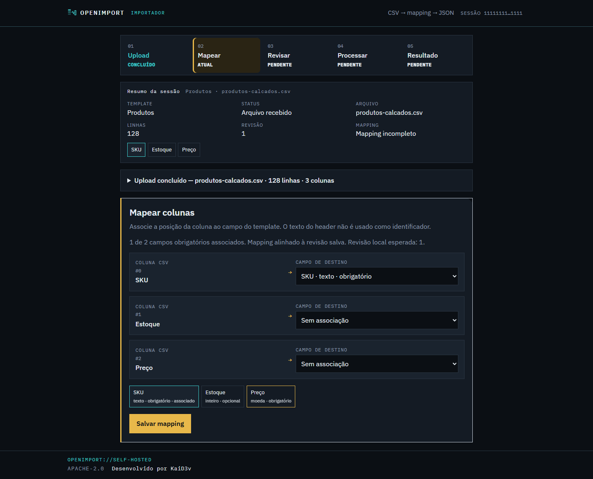
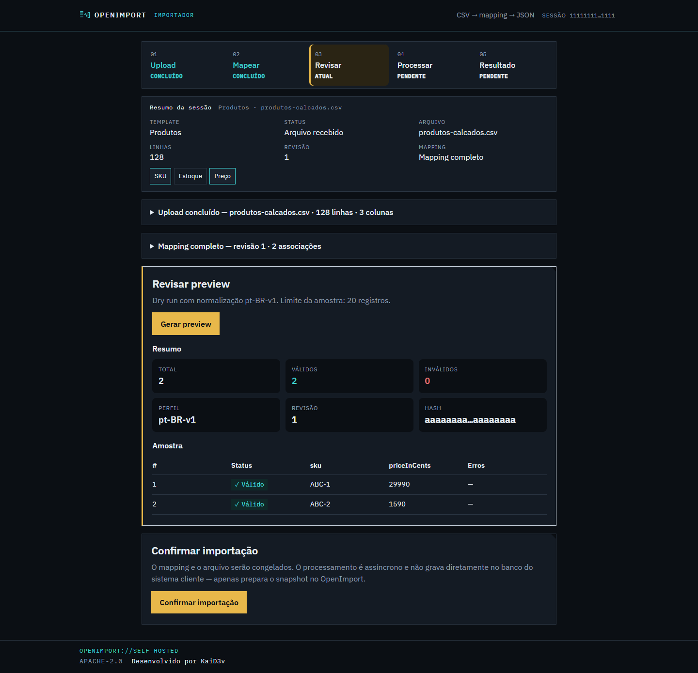
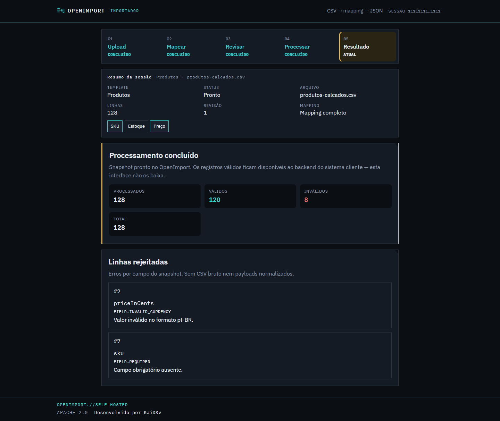

# OpenImport

**Transforme CSV em payloads confiáveis de API.**

OpenImport é uma API self-hosted de importação, com uma bancada embarcável. O sistema cliente define o template, cria a sessão e entrega um token temporário ao iframe. O operador envia o CSV, mapeia colunas, revisa o preview e confirma. O OpenImport normaliza no perfil `pt-BR-v1`, processa em fila e devolve um snapshot de registros válidos e rejeitados — **sem acessar o banco do cliente** e **sem colocar a API key no navegador**.

Licença [Apache-2.0](LICENSE).

## O problema

Quase todo produto SaaS acaba pedindo uma planilha. Cada time reimplementa o mesmo fluxo: CSV com `;` ou `,`, headers que mudam de cliente para cliente, `R$ 299,90` que precisa virar `29990`, linhas inválidas que não podem ir para produção, e um operador humano no meio do caminho.

OpenImport isola essa etapa. O backend do cliente continua dono dos dados finais; o OpenImport só entrega um snapshot validado.

| Sem OpenImport | Com OpenImport |
| --- | --- |
| Parser, mapping e normalização no produto | Pipeline HTTP pronto (upload → mapping → preview → snapshot) |
| API key no frontend ou upload sem revisão | Token `oi_import_` de curta duração, só em memória |
| Moeda e locale improvisados | Perfil `pt-BR-v1` (centavos, inteiros, strings) |
| Erros misturados com o banco de produção | Rejeições paginadas; válidos só no backend do host |

## Como funciona

1. **Upload** — o host cria a sessão; o operador envia um CSV.
2. **Mapear** — coluna → campo por posição, não pelo texto do header.
3. **Validar** — preview síncrono com normalização `pt-BR-v1`, totais e erros por linha.
4. **Processar** — a confirmação congela arquivo + mapping; um worker em Redis/BullMQ gera o snapshot.
5. **Entregar** — registros válidos via API do host; webhook assinado `import.ready` opcional.

O iframe responde ao parent com `openimport.ready`, `openimport.loaded` e `openimport.error`. A origem precisa ser explícita — nunca `*`.

## Interface

Landing pública, com o pipeline e o contrato de embed:



Bancada de importação — envio do CSV:



Mapping coluna → campo do template:



Preview dry-run e confirmação:



Snapshot pronto, com linhas rejeitadas:



A rota de produção é `/imports/:importId`. Em desenvolvimento, `/dev` é o laboratório (não entra no bundle de produção).

## Instalação local

Requer **Node.js 24**, **npm** e **Docker Compose v2**. A versão de referência está em [`.nvmrc`](.nvmrc).

O Compose de desenvolvimento sobe PostgreSQL 17 (`localhost:5434`), Redis 7.4 (`localhost:6379`) e MinIO (`localhost:9000`, console em `:9001`). Não reutilize essas credenciais fora deste ambiente.

### 1. Infraestrutura

Na raiz do repositório:

```bash
docker compose up -d
```

Espere os healthchecks (Postgres, Redis e MinIO). O serviço `minio-init` cria o bucket `openimport`.

### 2. Backend

```bash
cd backend
cp .env.example .env
```

No Windows (PowerShell): `Copy-Item .env.example .env`.

Gere a chave de seed e a chave de cifra dos webhooks, e cole os valores em `backend/.env`. **Não versione o `.env`.**

```bash
node -e "console.log('oi_live_'+require('crypto').randomBytes(32).toString('hex'))"
node -e "console.log(require('crypto').randomBytes(32).toString('hex'))"
```

- `SEED_API_KEY` — `oi_live_` + 64 hex minúsculos. Use essa chave só no servidor (curl, seed, backend do host). Nunca no frontend.
- `WEBHOOK_SECRET_ENCRYPTION_KEY` — 64 hex minúsculos.

O `.env.example` já aponta `DATABASE_URL`, `REDIS_URL`, MinIO e CORS para `http://localhost:5173`.

```bash
npm install
npm run prisma:generate
npm run prisma:migrate:deploy
npm run prisma:seed
npm run start:dev
```

Use `prisma:migrate:deploy` nas migrations já versionadas. Não use `prisma db push` e não crie uma migration só para instalar.

URLs locais:

| Serviço | Endereço |
| --- | --- |
| API | http://localhost:3000/api/v1 |
| Liveness | http://localhost:3000/health |
| Readiness | http://localhost:3000/health/ready |
| Swagger | http://localhost:3000/docs |

### 3. Frontend

Em outro terminal, a partir da raiz:

```bash
cd frontend
cp .env.example .env
npm install
npm run dev
```

O Vite sobe em **http://localhost:5173**. O `.env.example` já usa `VITE_OPENIMPORT_API_BASE_URL=http://localhost:3000/api/v1` e origens do parent `http://localhost:5173`.

### 4. Abrir o laboratório

1. Confirme o backend: http://localhost:3000/health/ready deve responder `{"status":"ok"}`.
2. Abra http://localhost:5173 — a home descreve o pipeline.
3. Em desenvolvimento, **Abrir laboratório** leva a `/dev`.

O laboratório precisa de um `importId` e de um token `oi_import_`, emitidos com a API key de seed (nunca no navegador). A partir da raiz do repositório:

```bash
export API_KEY='oi_live_…'   # valor de SEED_API_KEY no backend/.env
API=http://localhost:3000/api/v1

# 1) Template
curl -sS -X POST "$API/templates" \
  -H "Authorization: Bearer $API_KEY" \
  -H "Content-Type: application/json" \
  --data-binary @backend/docs/examples/products-template.json

# 2) Sessão — troque <templateId> pelo id da resposta anterior
curl -sS -X POST "$API/imports" \
  -H "Authorization: Bearer $API_KEY" \
  -H "Content-Type: application/json" \
  -H "Idempotency-Key: local-dev-001" \
  -d '{"templateId":"<templateId>"}'

# 3) Token — o accessToken aparece só nesta resposta
curl -sS -X POST "$API/imports/<importId>/access-tokens" \
  -H "Authorization: Bearer $API_KEY" \
  -H "Content-Type: application/json" \
  -d '{"expiresInSeconds":1800}'
```

Cole `importId` e `accessToken` em `/dev` e envie um CSV de [`backend/docs/examples/`](backend/docs/examples/) (`products-valid.csv` ou `products-invalid.csv`). Mapping sugerido: coluna `#0` → `sku`, `#1` → `stock`, `#2` → `priceInCents`.

Walkthrough HTTP completo (preview, confirm, rejected-rows e results): [Referência HTTP](backend/docs/api-reference.md#walkthrough-reproduzível).

### 5. Encerrar

```bash
# nos terminais do backend e do frontend: Ctrl+C
docker compose down
```

Os volumes do Compose (Postgres, Redis, MinIO) permanecem. `docker compose down -v` apaga dados locais.

## Documentação

| Público | Onde |
| --- | --- |
| Backend (setup, API, arquitetura) | [`backend/README.md`](backend/README.md) e [`backend/docs/README.md`](backend/docs/README.md) |
| Frontend (embed, `/dev`, variáveis) | [`frontend/README.md`](frontend/README.md) |
| Self-host / produção | [`docs/deployment.md`](docs/deployment.md) |

O repositório tem dois apps independentes: `backend/` (NestJS, Prisma, BullMQ) e `frontend/` (React, Vite). Não há login de usuário, listagem de importações, XLSX nem gestão de API keys por HTTP — a chave de organização vive no servidor do host.

## Licença

Apache-2.0. Ver [`LICENSE`](LICENSE).
