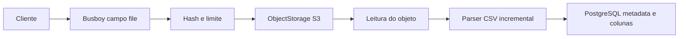

# Arquitetura atual

O backend NestJS expõe uma API multi-tenant. A organização vem exclusivamente da API key verificada; o cliente não envia `organizationId` e o serviço nunca se conecta ao banco do sistema cliente.

## Camadas e responsabilidades

- `ConfigModule`: valida ambiente com Zod e fornece `ENV`.
- `AuthModule`: `ApiKeyGuard` global, `ApiKeyService` e decorator `CurrentOrganization`. As rotas de negócio exigem Bearer; health e, quando habilitados, Swagger/OpenAPI são públicos.
- `TemplateModule`: controller, serviço e repository para templates e fields.
- `ImportModule`: controller, serviço/repository de sessões, mapping, CSV e `PreviewService`.
- `ObjectStorageModule`: porta `OBJECT_STORAGE`; `S3ObjectStorage` é o adaptador S3/MinIO.
- `DatabaseModule`: `PrismaService` com adapter PostgreSQL.
- HTTP transversal: Helmet, CORS, validation pipe estrita, Pino, request ID e filtro de exceções.

Controllers recebem HTTP/DTOs, serviços aplicam regras e orquestram fluxos, repositories mantêm queries escopadas por organização. A validação global rejeita propriedades não permitidas com `400`, proíbe valores desconhecidos e transforma apenas os tipos previstos pelos DTOs.

## Upload em streaming

O upload verifica estado e multipart, transmite bytes ao storage com hash/limite, depois relê o objeto para parsear e persistir metadados e colunas ordenadas. Exceder o limite de bytes acontece no stream de upload e mantém `created`; falha CSV após gravar o objeto tenta cleanup e marca `upload_failed`. O trabalho acontece dentro da requisição: não há worker, fila, progresso assíncrono ou processamento definitivo.

## Mapping e preview

Mapping é JSONB na sessão, associado por posição de coluna e `fieldKey`, com compare-and-swap por `mappingRevision`. O preview relê o objeto, confirma hash/colunas/contagem e revisão, normaliza todas as linhas e devolve estatísticas completas mais uma amostra. Ele não grava linhas normalizadas, não confirma importação e não chama sistema cliente.

## Onde ficam os dados

PostgreSQL armazena organizações, hash/prefixo de API keys, templates/fields, sessão, metadados de upload, colunas, mapping e revisão. O objeto CSV permanece no storage. Respostas não expõem `organizationId`, chave de storage nem hash de credencial.

Para estados e constraints, consulte [Persistência e estados](data-model.md). Para regras do stream, consulte [CSV e normalização](csv-and-normalization.md).
