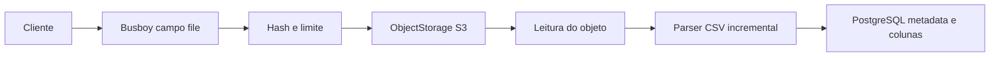

# Arquitetura atual

O backend NestJS expõe uma API multi-tenant. A organização vem da credencial autenticada: com API key, diretamente da chave verificada; com token de importação, da sessão vinculada, conferida com o token e a API key emissora. O cliente não envia `organizationId` e o serviço nunca se conecta ao banco do sistema cliente.

## Camadas e responsabilidades

- `ConfigModule`: valida ambiente com Zod e fornece `ENV`.
- `AuthModule`: `ApiKeyGuard` autentica Bearer (API key ou token de importação) e `ImportAuthorizationGuard` autoriza por tipo de credencial e `importId` persistido. A organização de um token vem da sessão e da API key emissora após checagem de consistência, não só da linha do token. `CurrentOrganization` continua expondo a organização; o contexto inclui `credential.type`. Health e, quando habilitados, Swagger/OpenAPI são públicos.
- `TemplateModule`: controller, serviço e repository para templates e fields.
- `ImportModule`: controller, serviço/repository de sessões, mapping, CSV, `PreviewService`, `ConfirmService`, `RejectedRowsService`, `ImportProcessingWorker` (BullMQ) e `ImportFileRetentionCleaner` (retenção de CSV no storage).
- `WebhookModule`: cadastro do endpoint `import.ready` (API key), outbox `webhook_deliveries` na mesma transação do CAS de ready, fila `webhook-delivery`, worker de POST assinado e reconciliador.
- `ObjectStorageModule`: porta `OBJECT_STORAGE`; `S3ObjectStorage` é o adaptador S3/MinIO.
- Redis + BullMQ: filas `import-processing` e `webhook-delivery`. Desenvolvimento usa Redis DB 0 (`REDIS_URL=.../0`); E2E usa DB 15 para não cruzar jobs com `start:prod`/`start:dev`.
- `DatabaseModule`: `PrismaService` com adapter PostgreSQL.
- HTTP transversal: Helmet, CORS, validation pipe estrita, Pino, request ID, filtro de exceções, timeouts HTTP (`headersTimeout` + `connectionsCheckingInterval`, `requestTimeout`, socket `timeout` para body parado, `keepAliveTimeout`, `maxRequestsPerSocket`) e rate limit Redis em duas fases (`PreAuthRateLimitGuard` por IP antes da autenticação; `PostAuthRateLimitGuard` por identidade estável + tier depois).

Controllers recebem HTTP/DTOs, serviços aplicam regras e orquestram fluxos, repositories mantêm queries escopadas por organização. A validação global rejeita propriedades não permitidas com `400`, proíbe valores desconhecidos e transforma apenas os tipos previstos pelos DTOs.

## Upload em streaming

O upload verifica estado e multipart, transmite bytes ao storage com hash/limite, depois relê o objeto para parsear e persistir metadados e colunas ordenadas. Exceder o limite de bytes acontece no stream de upload e mantém `created`; falha CSV após gravar o objeto tenta cleanup e marca `upload_failed`.

## Mapping, preview e confirmação

Mapping é JSONB na sessão, associado por posição de coluna e `fieldKey`, com compare-and-swap por `mappingRevision`. O preview relê o objeto, confirma hash/colunas/contagem e revisão, normaliza todas as linhas e devolve estatísticas completas mais uma amostra. Ele não grava linhas normalizadas.

`POST .../confirm` congela mapping+arquivo, cria `ImportExecution` e enfileira o worker. O worker reutiliza o mesmo parser e normalizadores (`pt-BR-v1`), persiste `ImportRecord` válidos/inválidos com upsert por `(executionId, recordNumber)`, atualiza progresso em batches e só então marca `ready`. O CAS de ready (execução+sessão) e a inserção de `webhook_deliveries` pending, se houver endpoint ativo, compartilham a mesma transação; o POST HTTP acontece depois do commit, na fila `webhook-delivery`. Falhas terminais usam `failExecutionAndDiscardRecords` (CAS da execução → failed, depois delete de records, depois sessão `processing_failed` na mesma transação; CAS perdido na sessão faz rollback). Em desenvolvimento, API, worker e reconciliador de jobs compartilham o processo Nest; em produção, separe o processo worker quando a carga exigir. O publisher compartilhado (`ImportProcessingJobPublisher`) só devolve sucesso para execução `queued`|`processing` quando existe job BullMQ processável; `unknown` persistente e terminal não removível falham (`503 IMPORT.PROCESSING_UNAVAILABLE` / retry do reconciliador). Uma reconsulta controlada trata race em que o job some após `unknown`. Paginação por cursor evita starvation. `jobId`: `import-process.{sessionId}.{fingerprint}`. Entregas de webhook usam `jobId` `webhook-delivery.{deliveryId}` e o mesmo critério de job processável (`WebhookDeliveryJobPublisher`): `queue.add()` não basta; após o add o publisher reconsulta e exige estado processável. Falha de enqueue não altera `ready`. Deliveries pending órfãs são recuperáveis pelo reconciliador quando Redis volta a um estado saudável.

## Onde ficam os dados

PostgreSQL armazena organizações, hash/prefixo de API keys, hash/prefixo de tokens de importação, templates/fields, sessão, metadados de upload, colunas, mapping, execução, registros normalizados/erros, endpoint de webhook (URL + segredo cifrado) e deliveries `import.ready` com snapshot de URL, payload e ciphertext. O objeto CSV permanece no storage até a retenção expirar para sessões terminais elegíveis; depois só a evidência `storageDeletedAt` fica no PostgreSQL. Respostas não expõem `organizationId`, chave de storage, hash de credencial nem o segredo completo do webhook após a criação.

DLQ completa / bull-board / cancelamento ficam fora desta fatia; retries BullMQ limitados + `processing_failed` cobrem falhas definitivas de importação, e deliveries de webhook esgotadas ficam `failed` sem alterar `ready`. O cleaner de CSV usa claim/CAS in-process (sem job BullMQ por arquivo). Estratégia futura: fila DLQ dedicada e retenção auditável de jobs falhos.

Para estados e constraints, consulte [Persistência e estados](data-model.md). Para regras do stream, consulte [CSV e normalização](csv-and-normalization.md).
