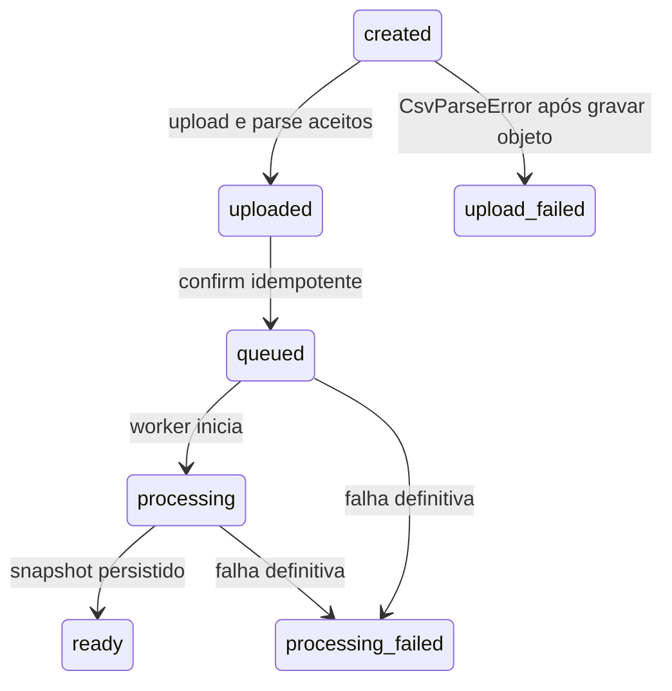

# Persistência e estados

## Entidades

```text
Organization 1--* ApiKey
Organization 1--* ImportTemplate 1--* TemplateField
Organization 1--* ImportSession *--1 ImportTemplate
Organization 1--* ImportAccessToken
Organization 1--* ImportExecution
Organization 1--* ImportRecord
ApiKey 1--* ImportAccessToken
ImportSession 1--* ImportColumn
ImportSession 1--* ImportAccessToken
ImportSession 1--* ImportExecution 1--* ImportRecord
```

IDs são UUID v7. `ImportSession.templateId` usa `onDelete: Restrict`; `ImportAccessToken.issuerApiKeyId` usa `onDelete: Restrict`; as relações de organização, fields, columns, tokens, executions e records usam cascade.

| Entidade | Dados principais |
| --- | --- |
| `Organization` | nome e timestamps |
| `ApiKey` | `keyHash` SHA-256 único, prefixo, `revokedAt` |
| `ImportAccessToken` | `tokenHash` SHA-256 único, prefixo, sessão, emissor, `expiresAt`, `revokedAt` |
| `ImportTemplate` / `TemplateField` | nome por organização, fields ordenados por `position` |
| `ImportSession` | status, hashes de idempotência/fingerprint, metadata do arquivo, `mapping` JSONB, `mappingRevision`, `confirmedAt` |
| `ImportColumn` | nome e posição de header após upload |
| `ImportExecution` | fingerprint de confirmação, revisão/hash congelados, `jobId`, progresso, status da tentativa |
| `ImportRecord` | `recordNumber`, `valid`/`invalid`, `payload` JSON (válido) ou `errors` JSON (inválido) |

## Unicidade e índices

- API key: `keyHash` único; índice por organização.
- Token de importação: `tokenHash` único; índices por sessão, organização e `expiresAt`.
- Template: `(organizationId, name)` único.
- Field: `(templateId, key)` e `(templateId, position)` únicos.
- Sessão: `(organizationId, idempotencyKeyHash)` único; índices por organização, `(organizationId, templateId)` e `(organizationId, id)`.
- Coluna: `(importSessionId, position)` e `(importSessionId, name)` únicos, além de índice por sessão.
- Execução: `(importSessionId, confirmationFingerprint)` único; `jobId` único.
- Registro: `(executionId, recordNumber)` único; queries sempre filtradas por `organizationId`.

Migrations versionadas incluem `20260903214207_import_confirm_processing`.

## Status da sessão

Valores: `created`, `uploaded`, `queued`, `processing`, `ready`, `processing_failed`, `upload_failed`.



Em `uploaded`, mapping e preview são permitidos. Após `queued`, mapping e preview são bloqueados (`IMPORT.MAPPING_NOT_ALLOWED` / `IMPORT.PREVIEW_NOT_ALLOWED`). `upload_failed` não é reutilizado para falhas do worker — use `processing_failed`.

Registros parcialmente escritos de uma execução falha **não** formam snapshot pronto: `GET .../rejected-rows` e `GET .../valid-rows` exigem `ready`. `valid-rows` usa o índice `(organizationId, importSessionId, classification, recordNumber)` com filtro adicional por `executionId`.

Resultados do cliente (`ImportResultBatch` / `ImportRecordResult`) vinculam-se à execução `ready`. A chave idempotente do lote é guardada só como hash; o resultado final por `(executionId, recordNumber)` é único e não sobrescrevível. `isComplete` no resumo significa `pending === 0` e **não** altera o status `ready` da sessão.

## Idempotência e revisão

`POST /imports` exige `Idempotency-Key` (8–128, `[A-Za-z0-9._-]`). A sessão guarda hash da chave e fingerprint de `{ templateId }`, ambos por organização. Mesma chave e mesmo payload retorna a sessão original; payload diferente retorna `409 IDEMPOTENCY.KEY_REUSED`.

O mapping começa em revisão `0`. `PUT /imports/:importId/mapping` requer `expectedRevision` e atualiza apenas se revisão e status ainda coincidirem (`status: uploaded`). Pares semanticamente iguais são no-op.

Confirmação usa CAS `uploaded → queued` + fingerprint `(revision, contentSha256)`. Replay do mesmo snapshot retorna a mesma execução; BullMQ usa `jobId` determinístico `import-process.{sessionId}.{fingerprint}`. Replay e reconciliador consultam o estado público do job (não bastam `getJob` truthy): estados processáveis são mantidos; `failed`/`completed` com execução ainda `queued`|`processing` são removidos e republicados.

`POST /imports/:importId/results` exige `Idempotency-Key` com o mesmo formato. O lote guarda hash da chave e fingerprint canônico de `{ executionId, results ordenados por recordNumber }`. Replay idêntico retorna o mesmo `batchId`; payload diferente retorna `409 IDEMPOTENCY.KEY_REUSED`.
