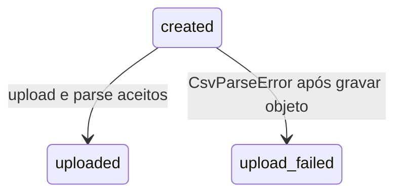

# Persistência e estados

## Entidades

```text
Organization 1--* ApiKey
Organization 1--* ImportTemplate 1--* TemplateField
Organization 1--* ImportSession *--1 ImportTemplate
ImportSession 1--* ImportColumn
```

IDs são UUID v7. `ImportSession.templateId` usa `onDelete: Restrict`; as relações de organização, fields e columns usam cascade.

| Entidade | Dados principais |
| --- | --- |
| `Organization` | nome e timestamps |
| `ApiKey` | `keyHash` SHA-256 único, prefixo, `revokedAt` |
| `ImportTemplate` / `TemplateField` | nome por organização, fields ordenados por `position` |
| `ImportSession` | status, hashes de idempotência/fingerprint, metadata do arquivo, `mapping` JSONB e `mappingRevision` |
| `ImportColumn` | nome e posição de header após upload |

## Unicidade e índices

- API key: `keyHash` único; índice por organização.
- Template: `(organizationId, name)` único.
- Field: `(templateId, key)` e `(templateId, position)` únicos.
- Sessão: `(organizationId, idempotencyKeyHash)` único; índices por organização, `(organizationId, templateId)` e `(organizationId, id)`.
- Coluna: `(importSessionId, position)` e `(importSessionId, name)` únicos, além de índice por sessão.

Há três migrations versionadas: `20260902204845_init`, `20260902215911_import_sessions` e `20260903060323_import_session_mapping`.

## Status da sessão

Os únicos valores são `created`, `uploaded` e `upload_failed`.



Em `created`, upload é permitido; mapping e preview retornam conflito. Em `uploaded`, novo upload retorna `IMPORT.FILE_ALREADY_UPLOADED` e mapping/preview são permitidos. Em `upload_failed`, retry de upload, mapping e preview são bloqueados (`IMPORT.UPLOAD_NOT_ALLOWED` para upload). Rejeição antes do objeto ser aceito — multipart/MIME inválido ou `IMPORT.FILE_TOO_LARGE` — mantém `created`; `CsvParseError` após storage tenta cleanup e produz `upload_failed`.

Não existem `processing`, `completed`, `previewed`, `failed` genérico, `cancelled` ou estado separado de mapping.

## Idempotência e revisão

`POST /imports` exige `Idempotency-Key` (8–128, `[A-Za-z0-9._-]`). A sessão guarda hash da chave e fingerprint de `{ templateId }`, ambos por organização. Mesma chave e mesmo payload retorna a sessão original; payload diferente retorna `409 IDEMPOTENCY.KEY_REUSED`.

O mapping começa em revisão `0`. `PUT /imports/:importId/mapping` requer `expectedRevision` e atualiza apenas se revisão e status ainda coincidirem. Pares semanticamente iguais, inclusive em ordem diferente, são no-op e não incrementam revisão. Limpar um mapping não vazio incrementa a revisão.

`isComplete` significa que existe pelo menos uma associação e todos os fields obrigatórios estão mapeados. Não altera o status e não informa validade das linhas. A validade só é calculada no preview por record; uma sessão com mapping completo pode retornar linhas inválidas em HTTP 200.
